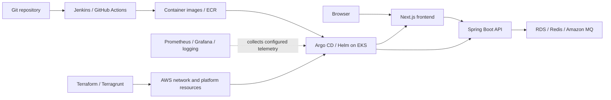

# Amazon Clone DevOps Lab

An evolving portfolio project for a small e-commerce application and its AWS delivery platform. The repository contains Java/Spring Boot and Next.js application code, Terraform/Terragrunt infrastructure, Kubernetes and Helm deployment resources, Jenkins and GitHub Actions pipelines, and operational/security examples.

This is a learning and demonstration project. The repository does not establish production use, customer traffic, service-level objectives, compliance certification, or a currently healthy live deployment.

## Current status

| Area | Repository status | Evidence / boundary |
|---|---|---|
| Application | Implemented in source | Spring Boot backend and Next.js frontend are present. A successful end-to-end deployment is not established by source alone. |
| Infrastructure | Implemented in configuration | Terraform modules and Terragrunt environment definitions cover AWS resources including VPC, EKS, RDS, ElastiCache, Amazon MQ, IAM, ECR, S3, DNS, Cognito, and budgets. Provisioning success is not asserted here. |
| Kubernetes delivery | Implemented in configuration | Helm chart and Argo CD resources are present. Current cluster state was not independently verified. |
| Observability and operations | Partially implemented in configuration | Prometheus/Grafana dashboards, logging resources, cost exporter, runbooks, and automation examples are present. Their current runtime state is unverified. |
| Security automation | Implemented as project configuration | CI definitions and policy examples include dependency/container/IaC scanning, secret scanning, Kyverno policies, and Ansible hardening. A control mapping is not a certification or independent compliance assessment. |
| GitHub Actions on `main` | **Failing in the latest visible run found during this review (November 13, 2026)** | The latest visible `Amazon Clone CI/CD` run, from March 25, 2026, failed in both `backend-build` and `frontend-build`; dependent Docker and DAST jobs were skipped. [Open the run](https://github.com/mkdevops89/amazon-clone-devops/actions/runs/23544858142). The public job summary did not expose failed-step details during this review. |
| Project roadmap | Ongoing | `main` contains a Phase 20 commit. Phase-named branches record earlier iterations; they are not all separate, currently supported deployment paths. |

The latest visible main-branch workflow result is a failure, so this README does not use a passing CI badge. Recheck the Actions page before relying on any status statement.

## Architecture

The diagram describes the main repository configuration. It does not claim that every component is currently provisioned or healthy.

See [architecture and delivery notes](docs/architecture.md) for component boundaries, historical workflow notes, and limitations.

## Technology

- **Application:** Java 17, Spring Boot, Maven, Next.js, React, TypeScript
- **AWS and infrastructure:** Terraform, Terragrunt, EKS, ECR, RDS MySQL, ElastiCache Redis, Amazon MQ, S3, Cognito, IAM
- **Deployment:** Docker, Kubernetes, Helm, Argo CD, Jenkins, GitHub Actions
- **Operations and security examples:** Prometheus, Grafana, Elasticsearch/Kibana/Filebeat, Trivy, Gitleaks/TruffleHog, OWASP ZAP, Kyverno, Ansible
- **AI example:** Spring AI with Amazon Bedrock, plus a frontend chat route

These are technologies referenced by repository configuration. This list does not imply that each service is currently running or that each scanner produces a passing result.

## Engineering decisions and security boundaries

- The repository has moved through multiple pipeline and infrastructure designs. The current default branch is the reference point for this overview; phase branches are historical snapshots.
- AWS infrastructure is configured for a development environment, but some current defaults need review before provisioning. In particular, the EKS public API endpoint, selected node ingress rules, and bastion ingress include `0.0.0.0/0`.
- The backend JWT signing value is now read from `JWT_SECRET` rather than embedded in `application.properties`. Provide a strong Base64-encoded value through a secret manager or local environment. The former value remains in Git history and should be rotated anywhere it may have been used. Do not place secrets in Git or build arguments.
- The tracked frontend `.env.production` contains Cognito identifiers and a public API URL used by browser code. These are client configuration values, not credentials. Keep confidential values out of `NEXT_PUBLIC_*` variables.
- Some manifests still use mutable image tags, and the current Jenkins agent definition includes privileged Docker-in-Docker. Treat those as hardening work, not secure defaults.
- The repository contains STIG-aligned examples. It has not been independently assessed or certified against DISA STIG, NIST, SOC 2, PCI DSS, or another standard.

## Validation and limitations

GitHub Actions provides build and scan workflows, but the latest visible `main` CI run failed in the frontend and backend build jobs. The public run summary did not provide step-level failure details during this review. Successful historical-branch runs are not evidence that the current `main` workflow passes.

The Terraform, Helm, Kubernetes, and Ansible files are configuration evidence. They do not prove current AWS account state, a successful clean-room deployment, production readiness, or recovery from a disaster. Cost, availability, security, and performance outcomes have not been independently measured here.

## Setup and teardown

This repository does not currently provide a verified one-command setup that creates the complete application platform. A full deployment depends on AWS credentials, configured Terraform/Terragrunt state, account-specific settings, GitHub/Jenkins secrets, DNS and certificates, and external service prerequisites. Review the environment files and runbooks before running infrastructure commands.

The AWS design includes billable resources such as EKS worker nodes, load balancers, NAT gateways, RDS, ElastiCache, Amazon MQ, EBS volumes, and log storage. Estimate cost in the target account before provisioning and inspect billing after teardown; deleting a cluster does not necessarily remove every dependent resource. RDS is configured with `skip_final_snapshot = true`, so destroying it can permanently remove database data.

For teardown, inventory resources and persistent volumes first, take any required backups, then destroy the Terragrunt-managed resources in dependency order and verify remaining resources in AWS. Do not treat the older [infrastructure destroy audit](docs/platform-review/infrastructure-destroy-audit.md) as an executable runbook until its commands and retention claims have been revalidated against the current configuration.

## Repository guide

| Path | Purpose |
|---|---|
| `backend/` | Spring Boot API and database migrations |
| `frontend/` | Next.js application |
| `ops/terraform/` | AWS infrastructure modules and Terragrunt environments |
| `ops/helm/`, `ops/k8s/` | Application and platform deployment configuration |
| `ops/ansible/`, `ops/scripts/` | Host hardening, operations, and helper scripts |
| `ops/security/`, `docs/security/` | Policy examples and security notes |
| `docs/runbooks/` | Operational procedures |
| `docs/platform-review/` | Project reviews and technical-debt notes; verify before execution |

## Suggested review order

1. Read the [architecture notes](docs/architecture.md) and inspect the current `main` branch.
2. Review the [latest GitHub Actions result](https://github.com/mkdevops89/amazon-clone-devops/actions/runs/23544858142) and its failed steps.
3. Review the open-access network rules and secret configuration before considering an AWS deployment.
4. Treat historical phase branches and older runbooks as project history unless they are explicitly revalidated.
